# NatureChime

## _"Capture the world, one sound at a time."_

NatureChime is a Flutter-based mobile application that helps users discover, record, and catalogue the diverse audio environments around them. From the gentle rustling of leaves in a forest to the rhythmic clatter of a passing train, our world is full of distinctive sounds that often go unnoticed or undocumented. NatureChime lets users capture these moments, build personal sound libraries, and share their discoveries with others.

Unlike traditional audio recording apps that focus on voice memos or music creation, NatureChime is designed specifically for environmental sound collection, whether you're documenting bird calls, mapping city soundscapes, or simply appreciating unique audio experiences.

## Table of Contents

- [Overview](#overview)
- [Features](#features)
- [User Analysis](#user-analysis)
- [App Design](#app-design)
- [MVP Scope](#mvp-scope)
- [Project Architecture](#project-architecture)
- [Technical Implementation](#technical-implementation)
- [Development Guidelines](#development-guidelines)
- [Getting Started](#getting-started)

## Overview

### Purpose

NatureChime aims to create a community of sound enthusiasts who can:

- Record and preserve natural soundscapes
- Share their audio discoveries with others
- Explore sounds from different locations and environments
- Build personal collections of environmental audio

### Target Audience

- Nature enthusiasts and field recordists
- Environmental researchers and scientists
- Sound designers and audio professionals
- General users interested in natural sounds

### Key Differentiators

- High-quality audio recording with custom parameters
- Location tagging for each recording
- Comprehensive sound organisation system
- Cross-platform compatibility (iOS and Android)

## Features

### Core Functionality

**Authentication and Profile**

- Email/password login and Google Sign-in
- Password reset and account deletion
- Account creation with profile picture upload
- Personal profile with profile picture, username, and email
- Log out functionality

**Sound Recording and Capture**

- One-touch recording (start/stop)
- Automatic metadata capture (time, date)
- Manual title and description entry
- Location tagging

**Sound Organisation and Management**

- List of recordings (title, date recorded)
- Edit recording details (rename, update description)
- Delete recordings (with confirmation prompt)
- Search recordings by title

**Playback**

- Play/pause controls and seek bar
- Recording details displayed during playback
- Edit/delete options for the user's own recordings

**UI and Navigation**

- Home screen showing recent recordings
- Bottom navigation between Home, Record, Library, Explore, and Profile
- Loading and error handling

### Additional / Stretch Features

- **Advanced audio:** adjustable quality settings, waveform visualisation, audio trimming, noise reduction
- **Organisation:** tagging, categories, search and filtering by title, location, and date
- **User experience:** dark mode, favourites, offline recording with later sync, export and sharing
- **Community:** public/private recordings, likes and comments, following other users, featured collections

## User Analysis

### Target User Groups

**Nature Enthusiasts and Outdoor Adventurers** document authentic natural soundscapes during outdoor activities, preserving memories and building collections from different environments, seasons, and locations.

**Urban Explorers and City Dwellers** are fascinated by the sounds of urban environments, from subway stations to historic buildings, and enjoy documenting the acoustic character of different neighbourhoods.

**Mindfulness Practitioners and Sound Therapy Users** collect calming sounds, such as gentle rainfall or distant wind chimes, for meditation, relaxation, or sound therapy.

### Potential User Groups

**Content Creators and Educators** (podcasters, filmmakers, teachers) value high-quality recordings and detailed metadata for reuse in creative and educational projects.

**Acoustic Ecology Enthusiasts and Researchers** document changing soundscapes for cultural preservation, environmental awareness, or scientific work.

### User Personas

**Emma, 34 - The Nature Enthusiast**
- *Background:* Wildlife biologist and amateur photographer
- *Motivation:* Documenting biodiversity through sound
- *Behaviours:* Regular hiking trips to national parks; interested in bird calls and seasonal variations in forest sounds
- *Usage:* Records weekly, meticulously tags and categorises findings, occasionally shares discoveries
- *Pain points:* Existing apps lack proper organisation systems for nature sounds

**Marcus, 27 - The Urban Sound Explorer**
- *Background:* Architecture student and podcast listener
- *Motivation:* Capturing the voice of different urban spaces
- *Behaviours:* Explores neighbourhoods on weekends; fascinated by how sound reflects cultural and structural aspects of cities
- *Usage:* Records spontaneously while commuting, uses location features heavily, shares favourites with friends
- *Pain points:* Wants better ways to organise city sounds; existing apps focus too much on music or voice memos

**Sophia, 42 - The Mindfulness Practitioner**
- *Background:* Yoga instructor and wellness blogger
- *Motivation:* Collecting calming sounds for classes and personal practice
- *Behaviours:* Seeks out peaceful environments, records longer ambient soundscapes
- *Usage:* Selective recording, focused on playback quality, less interested in social features
- *Pain points:* Other apps pick up too much ambient noise; wants clean recordings for professional use

### Competitive Advantage

**Compared to general recording apps (Voice Memos, field recording apps)**
- Purpose-built interface for environmental sounds
- Automatic metadata and context capture
- Organisation designed around sound types, not just dates or titles
- Community of like-minded sound enthusiasts

**Compared to social audio platforms (SoundCloud, audio-sharing apps)**
- Focus on environmental sounds rather than music or podcasts
- Location-based discovery
- More detailed metadata and context preservation
- More privacy options for personal collections

**Compared to professional sound equipment/software**
- Accessible to non-technical users
- Mobile-first for spontaneous recording
- Built-in community and discovery features
- No expensive equipment required

NatureChime fills a niche between professional audio tools and casual recording apps, balancing functionality, community engagement, and ease of use.

## App Design

Each screen shows the original wireframe (left) next to the final implementation (right), with notes on where they differ.

### Key Screen Designs and User Flows

#### Welcome Screen

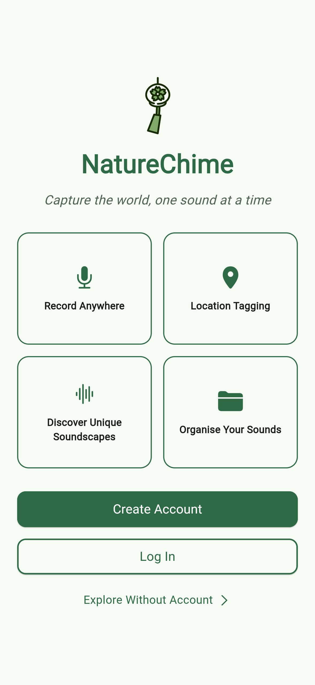 &nbsp;&nbsp;&nbsp; 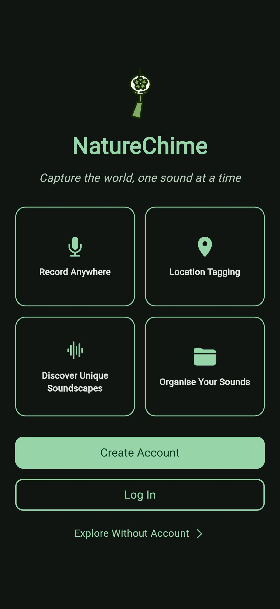

#### Login Screen

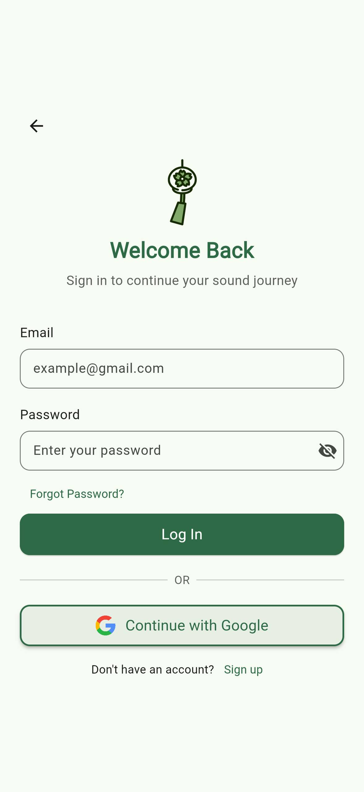 &nbsp;&nbsp;&nbsp; 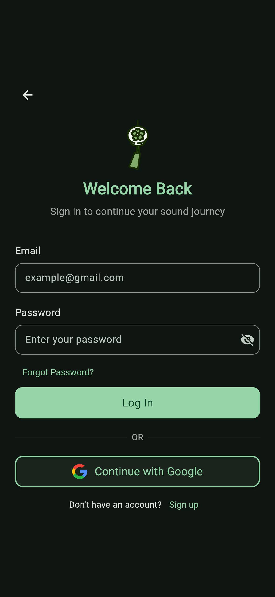

#### Create Account Screen

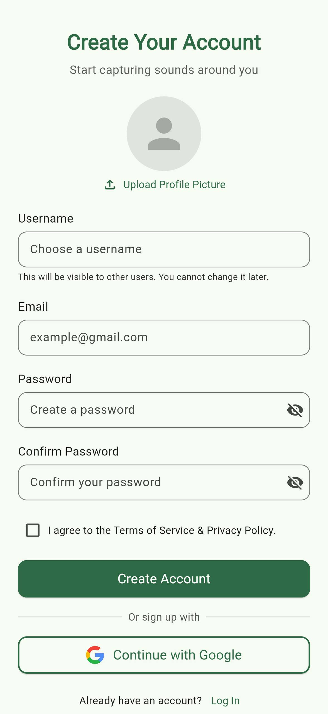 &nbsp;&nbsp;&nbsp; 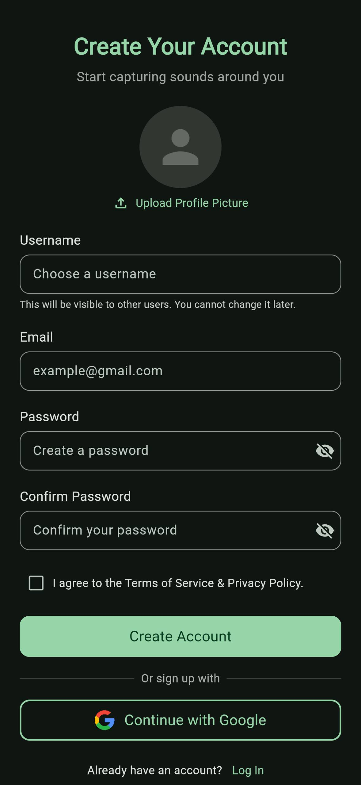

#### Authentication Flow

The welcome screen introduces users to NatureChime's core functionalities. New users can create an account with email or Google login, while returning users enter through a streamlined login process. The account creation screen collects essential information while clearly communicating privacy practices.

**Key Design Elements:**

- Brief, iconographic representation of core features
- Clear call-to-action buttons for Sign Up and Login
- Option to explore limited features before signing up

**User Flow:**

From the welcome screen, users can either:

1. Tap "Create Account" to create a new account (transitions to create account screen)
2. Tap "Log In" if they're returning users (transitions to login screen)
3. Tap "Explore Without Account" to browse public recordings without an account (transitions to explore screen)

> **Difference from Design:** The Create Account screen adds a note under the username field: _"You cannot change it later."_

#### Home Screen

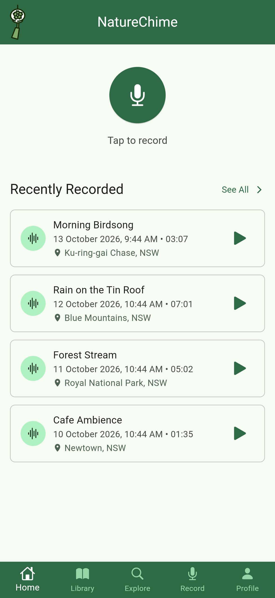 &nbsp;&nbsp;&nbsp; 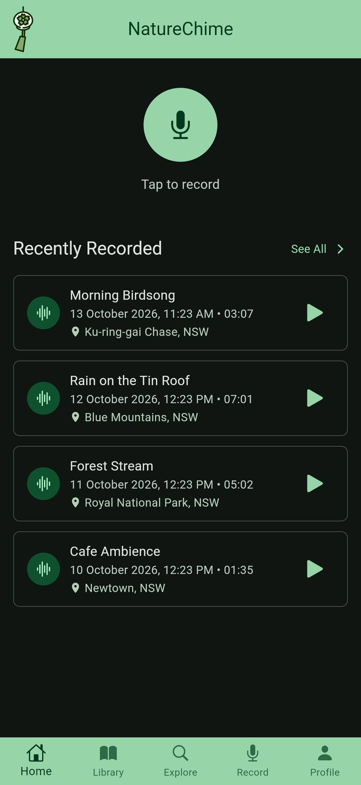

The Home screen features recently recorded sounds and quick-access recording control.

**Key Design Elements:**

- Floating action button for instant recording
- Four recent recordings displayed as lists with title, date, and location
- Bottom navigation providing access to all main sections

**User Flow:**

The dashboard connects to all primary functions:

1. Tap the microphone button to start recording (transitions to recording screen)
2. Tap any recent recording to view detailed playback (transitions to playback screen)
3. Use bottom navigation to access other main sections

> **Difference from Design:** The AppBar profile picture icon on the right side was omitted in the final implementation.

#### Library Screen

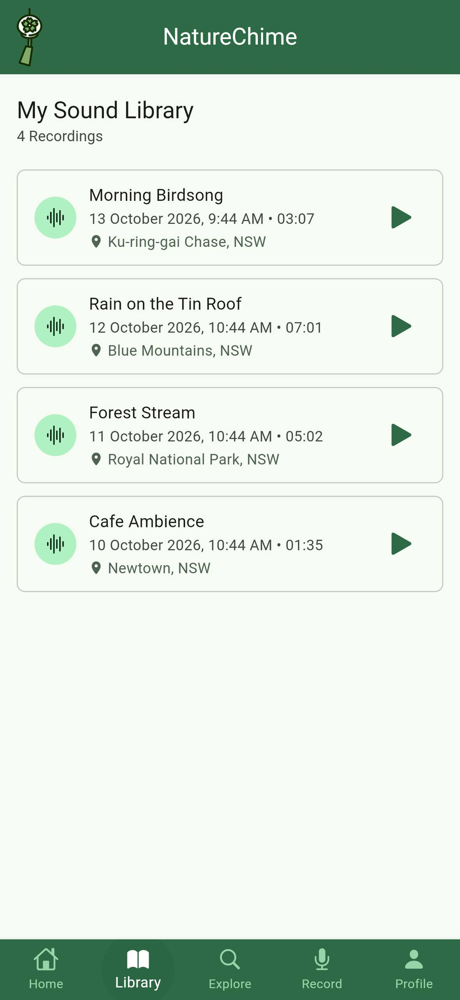 &nbsp;&nbsp;&nbsp; 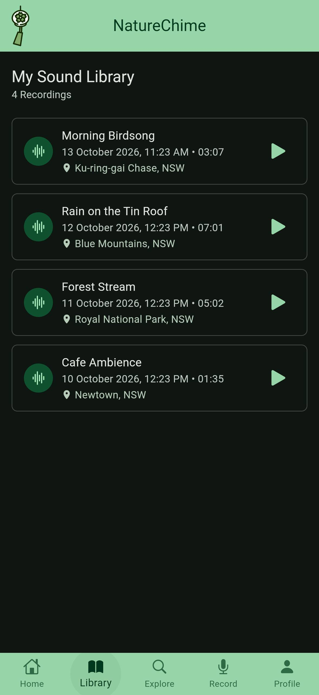

The Library screen provides a list view to browse personal recordings and a search button to look for a specific recording.

**Key Design Elements:**

- List view displays recordings with title, date, and location
- Search button to find recordings
- Number of total recordings shown at the top
- 3 dots icon to delete and edit on the right side of each recording list
- Bottom navigation providing access to all main sections

**User Flow:**

1. Tap any recording to open detailed view (transitions to playback screen)
2. Tap the search button to narrow results by title, date, or location
3. Tap 3 dots icon to delete recording or edit recording description
4. Use bottom navigation to access other main sections

#### Explore Screen

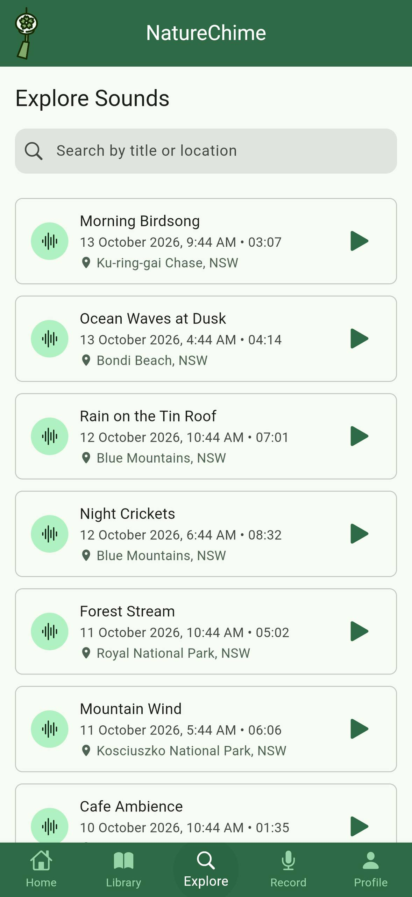 &nbsp;&nbsp;&nbsp; 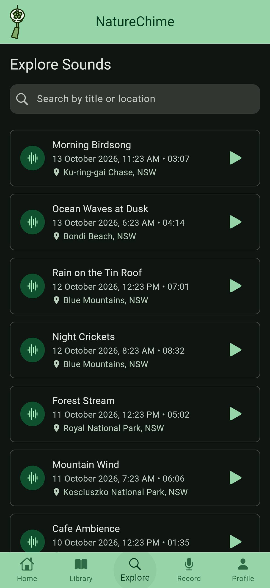

The Explore screen features a search bar and a list view for browsing recordings from other users, listening to them, and marking them as favorites.

**Key Design Elements:**

- The list view displays recordings with the title, the user who recorded them, the date, time, and location
- A search bar to find specific recordings
- A button for putting recording to Favourites

**User Flow:**

1. Tap any recording to open detailed view (transitions to playback screen)
2. Tap the search bar to narrow results by title, user, or location
3. Tap the heart icon to favourite a recording
4. Use bottom navigation to access other main sections

#### Record Screen

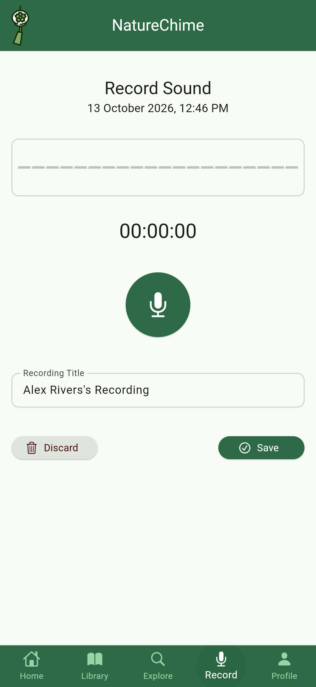 &nbsp;&nbsp;&nbsp; 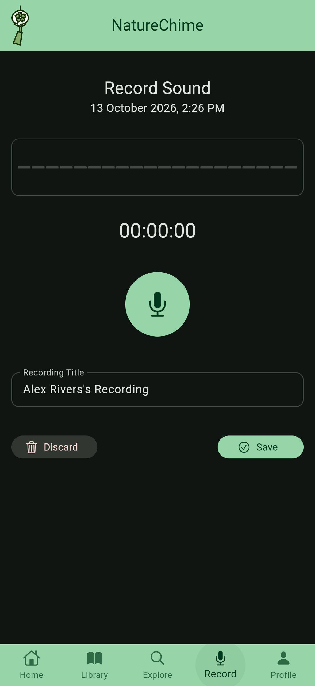

The Record screen focuses on essential functionality: starting, stopping, discarding and saving recordings.

**Key Design Elements:**

- Record button (Tap to start/stop)
- Recording timer displays elapsed time
- Audio level indication shows simple visual feedback for audio input levels
- Basic metadata capture (date/time of the recording)
- Manual title input
- Save/discard button

**User Flow:**

1. Tap the mic icon to start recording or stop recording
2. Input recording title
3. Save button to save the recording
4. Discard button to discard the recording

#### Profile Screen

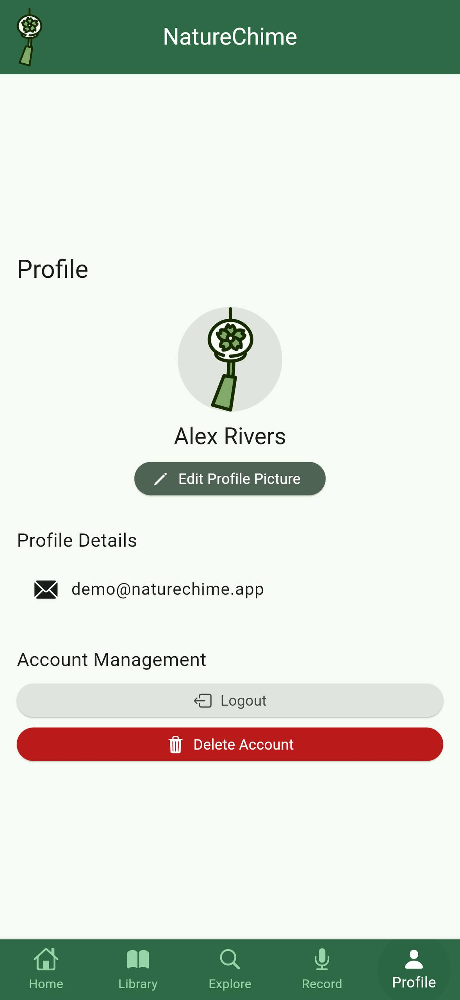 &nbsp;&nbsp;&nbsp; 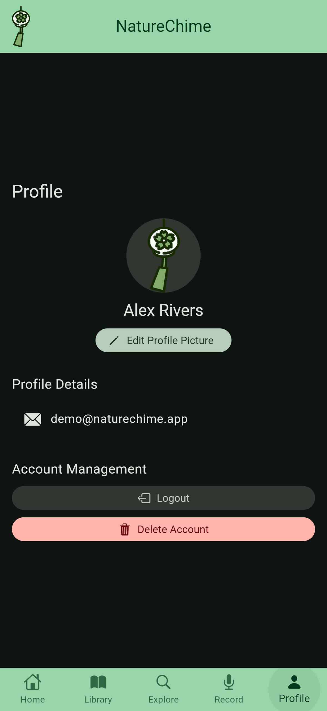

The Profile screen includes a profile picture, username, edit profile button, favourite recordings, and account management options.

**Key Design Elements:**

- Profile displaying a profile picture, username and edit profile button
- Last two favourite recordings with an option to view all favourite recordings
- Account management

**User Flow:**

1. Tap edit profile button to edit the profile picture and username
2. Tap on any of the favourite recording to open detailed view (transition to playback screen)
3. Tap the heart icon to unfavourite a recording
4. Tap Logout button to log out of the account
5. Tap Delete Account button to delete the account

> **Differences from Design:**
>
> - The _Edit Profile_ button was replaced with an **Edit Profile Picture** button.
> - The _Favourites_ functionality was removed from this screen.
> - Account management buttons (such as _Log out_, _Delete account_, etc.) are centered on the screen rather than left-aligned as originally planned.

#### Playback Screen

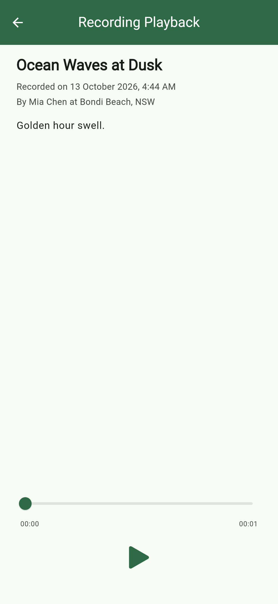 &nbsp;&nbsp;&nbsp; 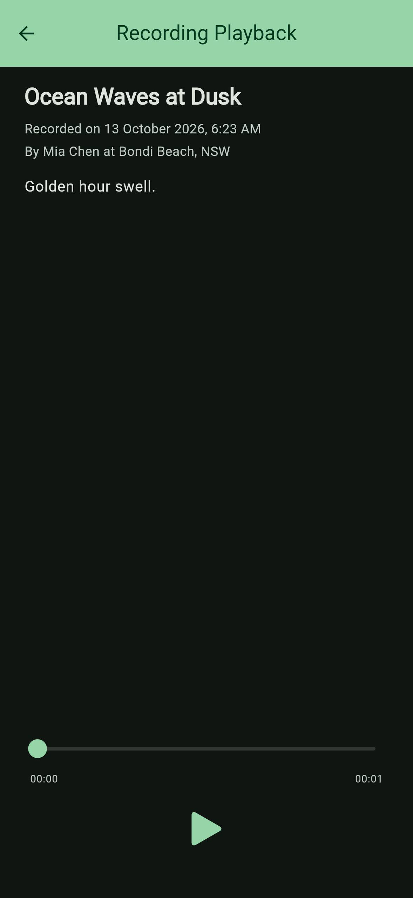

The Playback Screen allows users to navigate through the recording.

**Key Design Elements:**

- Play/pause button in the center of the control bar
- Seek bar that shows progress and allows users to navigate through the recording
- Elapsed time/total duration displays current position and total length in minutes:seconds format
- Recording details

**User Flow:**

1. Play/pause controls for immediate listening
2. Interact with seek bar to jump to specific parts
3. Tap back button to go back to previous page
4. Tap 3 dots icon to edit or delete a recording if the recording is owned by the user

### Transitions and Accessibility

- Smooth transitions between related screens maintain context, and playback controls transform naturally between states
- The design prioritises accessibility through high-contrast text options

## MVP Scope

### Core MVP Components

- **Authentication and profile:** email/password auth with Firebase, simple profile (username, email, profile picture), password reset and account deletion
- **Recording:** start/stop controls, duration display, location capture, manual title and description
- **Library management:** list of all user recordings, simple search by title, audio storage and retrieval
- **Playback:** play/pause, progress bar with seeking, recording information, edit/delete for own recordings
- **Basic UI:** clean navigation, responsive layouts, consistent styling, essential loading and error states

### Stretch Goals

- Dark mode toggle
- Filtering by date and predefined categories
- Waveform visualisation, advanced audio settings, audio trimming, noise reduction
- Public/private toggle, following users, comments and likes, featured collections
- Custom tags and advanced multi-parameter search
- Export/sharing and offline mode with synchronisation

### Development Prioritisation

1. Core audio recording and playback
2. User authentication and data storage
3. Basic CRUD operations for sound management
4. Essential UI components and navigation
5. Profile and settings functionality

This ensures the foundations are solid before adding more complex features, and that the MVP demonstrates all required CRUD operations while providing genuine utility.

## Project Architecture

### Directory Structure

```
lib/
├── firebase_options.dart        # Firebase configuration and setup
├── main.dart                    # Application entry point and initialisation
├── models/                      # Data models and state management
│   ├── recording_model.dart     # Sound recording data structure
│   └── user_model.dart          # User profile and settings
├── screens/
│   ├── welcome_screen.dart      # Landing page with auth options
│   ├── create_account_screen.dart # New user registration
│   ├── login_screen.dart        # User authentication
│   ├── main_screen.dart         # Main navigation container
│   ├── home_screen.dart         # Dashboard view
│   ├── library_screen.dart      # Recordings collection
│   ├── explore_screen.dart      # Discover other recordings
│   ├── record_screen.dart       # Audio recording interface
│   ├── profile_screen.dart      # User profile management
│   └── playback_screen.dart     # Audio playback interface
├── services/                    # Business logic and external services
│   └── auth_service.dart        # Authentication handling
├── utils/                       # Utility functions and helpers
│   ├── theme.dart               # Application theming
│   └── validators.dart          # Input validation
└── widgets/                     # Reusable UI components
```

### Architecture Pattern

The app follows a layered architecture:

1. **Presentation layer** (`screens/`, `widgets/`): UI rendering, user interaction, screen state, navigation, responsive design
2. **Business logic layer** (`services/`): application logic, data operations, external service integration
3. **Data layer** (`models/`): data structures, validation, state persistence

### Core Components

**`main.dart`**
- Initialises Firebase and environment variables
- Sets up the theme and providers
- Handles authentication state
- Routes to `WelcomeScreen` or `MainScreen` based on auth state

**`AuthService`**
- Email/password authentication
- Google Sign-in
- Password reset
- Account management
- Profile updates

## Technical Implementation

### State Management

- Provider for state management
- `ChangeNotifier` for authentication state

### Firebase Integration

**Authentication (Firebase Auth)**
- Email/password authentication with validation
- Google Sign-In OAuth integration
- Secure token management and refresh
- User session persistence

**Data Storage (Cloud Firestore)**
- User profiles and preferences
- Recording metadata and information
- Social interactions and relationships
- Location data for recordings
- Optimised queries with indexing

### Media Storage (Cloudinary)

- Audio file storage with compression
- Profile image storage and optimisation
- Secure access control

### Theme System

- Material Design 3 with consistent component styling
- Typography system with scale and responsive layout adaptations
- Dynamic colour generation from a seed colour, with light and dark variants
- Accessibility-compliant contrast and brand colour integration
- Custom components: styled audio player, recording visualisation, custom navigation, branded inputs, responsive containers

### Navigation

- Bottom navigation bar for main sections
- `CupertinoPageRoute` for smooth transitions
- State maintained during navigation

## Development Guidelines

### Code Standards

- Follows Flutter's official style guide
- Consistent naming conventions

### Testing Strategy

- **Unit tests:** business logic, model behaviour, service methods, utility functions
- **Widget tests:** component rendering, user interaction simulation, state management, navigation flows

### Error Handling

- Comprehensive error catching with user-friendly messages
- Graceful degradation
- Crash reporting integration
- Network error management

### Performance

- Lazy loading
- Image and audio optimisation
- Memory and battery usage management
- Caching strategies

### Security

- Secure data transmission
- Input sanitisation
- Authentication token management
- File access control
- API key protection

## Getting Started

A one-time setup of API credentials is required to run the project.

**1. Prerequisites**

- Flutter installed (see the [official installation guide](https://flutter.dev/docs/get-started/install))
- An IDE such as VS Code or Android Studio with the Flutter plugin

**2. Clone the repository**

```bash
git clone https://github.com/HazeyWazy/naturechime.git
cd naturechime
```

**3. Configure Cloudinary credentials (`.env` file)**

The app uses Cloudinary to store recorded audio and profile images. In the project root (alongside `pubspec.yaml`), create a file named exactly `.env` containing:

```
CLOUDINARY_CLOUD_NAME=
CLOUDINARY_UPLOAD_PRESET=
CLOUDINARY_PROFILE_UPLOAD_PRESET=
```

**4. Install dependencies**

```bash
flutter pub get
```

**5. Configure Firebase**

The app uses Firebase for authentication and recording metadata. The configuration files (`lib/firebase_options.dart`, `android/app/google-services.json`, `ios/Runner/GoogleService-Info.plist`) will be generated. 
```bash
flutterfire configure
```

**5. Run the app**

```bash
flutter run
```

> Make sure your emulator has an active internet connection.